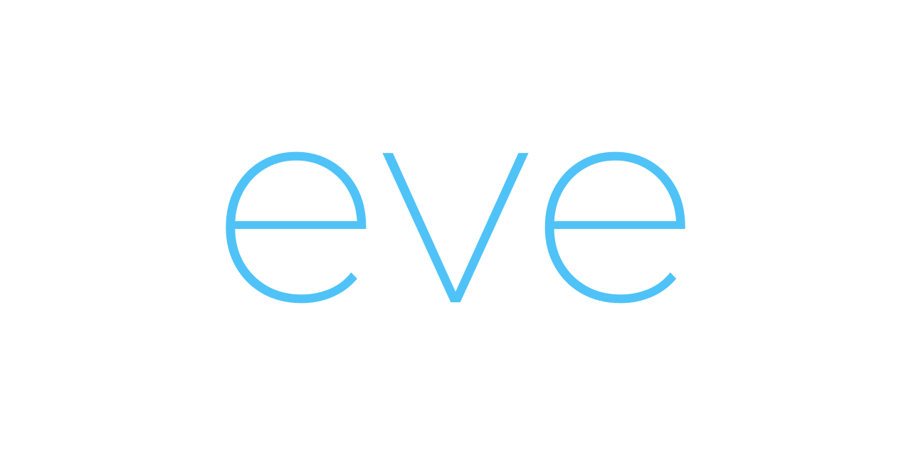

<p align="center">
  
</p>

<p align="center">
  <b>Talk to your computer from across the room.</b><br>
  A pocket push-to-talk stick that types what you say wherever your cursor is.
</p>

<p align="center">
  <a href="https://atech.dev"></a>
  
  
</p>

---

**eve** is a tiny USB-C voice stick. You hold its button and talk, and your
words appear in the window that has your cursor: a terminal, an editor, a chat
box. A **double-tap** presses Enter.

It was built for driving AI coding sessions (Claude Code and friends) while
walking around with the laptop open, so you don't have to stop and type. It
works in any app.

- **Live:** each phrase is typed as soon as you pause. You don't have to let go first.
- **Private:** speech recognition runs on your own computer with
  [faster-whisper](https://github.com/SYSTRAN/faster-whisper). No audio leaves the machine.
- **Hands-free Enter:** double-tap the button to send.
- **Plug and go:** no drivers. It reconnects by itself and starts at login.

## How it works

```
 ┌──────────── eve stick ────────────┐          ┌──────────── your computer ─────────────┐
 │  mic  ──▶  ESP32-S3  ◀──  button  │  USB-C   │  voicetype.py                          │
 │            streams 16 kHz audio   │ ───────▶ │   ├─ splits speech at pauses (VAD)     │
 │            while the button is    │          │   ├─ transcribes each phrase (Whisper) │
 │            held; double-tap = ⏎   │ ◀─────── │   └─ types it at your cursor (xdotool) │
 └───────────────────────────────────┘  light   └────────────────────────────────────────┘
```

The stick only captures and streams audio. Transcription runs on your
computer, because a small microcontroller can't run a good speech model.

## Hardware

eve is built from [**Atech**](https://atech.dev) plug-together modules, with
no soldering:

| Part | Where it goes |
|---|---|
| Atech **Tiny** board (ESP32-S3, 3 ports) | — |
| Atech **Microphone** module (ICS-43434, I²S) | ports 1 + 2 |
| Atech **Button** module (V2.0 for the RGB status light) | port 3 |
| Atech **USB-C** module | port 4 |
| A USB-C cable that carries **data** | — |

> On our unit the microphone answered on the opposite port lines from the board
> docs, so the firmware includes a wiring diagnostic (below). Run it if you get
> silence.

## Using it

| You do | eve does |
|---|---|
| **Hold** the button and talk | types each phrase as you pause |
| **Let go** | finishes and types the last phrase |
| **Double-tap** | presses Enter |
| Single quick tap | nothing, so bumps don't send anything |

The button light shows what's happening:

| Light | Meaning |
|---|---|
| green blink at power-up | firmware booted |
| **red** | listening |
| **amber** | finishing the last phrase |
| green flash | typed |
| blue flash | Enter |
| red flash | something went wrong (see the log) |

## Setup

Tested on Linux with X11. Typing uses `xdotool`, which doesn't work on Wayland.

### 1. Flash the stick

You need [PlatformIO](https://platformio.org) and the Atech driver library.
Get the driver library through [atech.dev](https://atech.dev).

```bash
export ATECH_LIB=/path/to/atech/firmware/esp32
cd firmware
pio run -t upload
```

If the upload times out, hold the board's **BOOT** button while it starts.

### 2. Install the desktop app

```bash
sudo apt install xdotool
python3 -m venv host/.venv
host/.venv/bin/pip install -r host/requirements.txt
```

### 3. Run it

```bash
host/.venv/bin/python host/voicetype.py
```

The first run downloads the speech model (~150 MB) once. Then hold the button
and talk.

To start it automatically every time you log in:

```bash
host/install-autostart.sh            # add flags after it, e.g. --model small.en
```

It logs to `~/.cache/voicetype.log`.

## Options

| Flag | What it does |
|---|---|
| `--model small.en` | more accurate on technical words, about 3× slower than the default `base.en` |
| `--pause 0.6` | how long a pause (seconds) ends a phrase. Default `0.4` |
| `--enter` | also press Enter every time you let go |
| `--no-live` | type everything at once when you let go |
| `--dry-run` | print the text instead of typing it |
| `--save-wav last.wav` | keep the last recording, for checking the mic |
| `-v` | also show the stick's log lines |

## Troubleshooting

**"waiting for the voice stick" forever.** The cable is probably charge-only,
or the firmware isn't flashed. `ls /dev/ttyACM*` should show a device.

**`error -71` in `journalctl -k`.** The laptop sees the stick but can't talk to
it, which means a bad data contact. Try another cable, then reseat the USB-C
module.

**Text is empty.** Record with `--save-wav last.wav` and play it with `aplay`.
If it's silent, run the wiring diagnostic:

```bash
cd firmware && pio run -e diag -t upload && pio device monitor
```

It tries every way the mic could be connected and reports which one is live.
Put those pins into `MIC_*` in `firmware/src/main.cpp`.

**Slow.** Transcription time depends on CPU speed. Laptops often throttle on a
low battery or a weak charger. Stay on `base.en`, or try `--model tiny.en`.

## Project layout

```
firmware/            PlatformIO project for the stick (ESP32-S3, Arduino)
  src/main.cpp       recording, button gestures, USB wire protocol
  diag/diag.cpp      microphone wiring diagnostic
host/
  voicetype.py       desktop app: VAD phrase splitting, Whisper, typing
  install-autostart.sh
assets/logo.svg
```

The USB protocol is small and documented at the top of `firmware/src/main.cpp`.
It's a good starting point for a different front end, such as a macOS or
Wayland typer, or a cloud speech backend.

## Credits

Made with [**Atech**](https://atech.dev) hardware modules. Speech recognition by
[faster-whisper](https://github.com/SYSTRAN/faster-whisper) and OpenAI's Whisper
models, with Silero VAD for phrase detection.

## License

[MIT](LICENSE)
